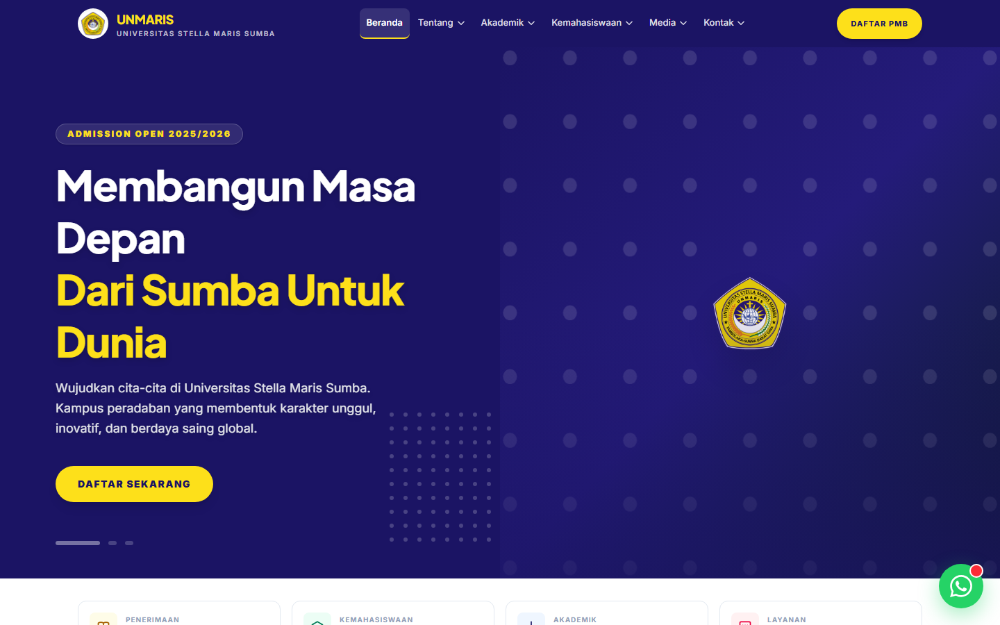
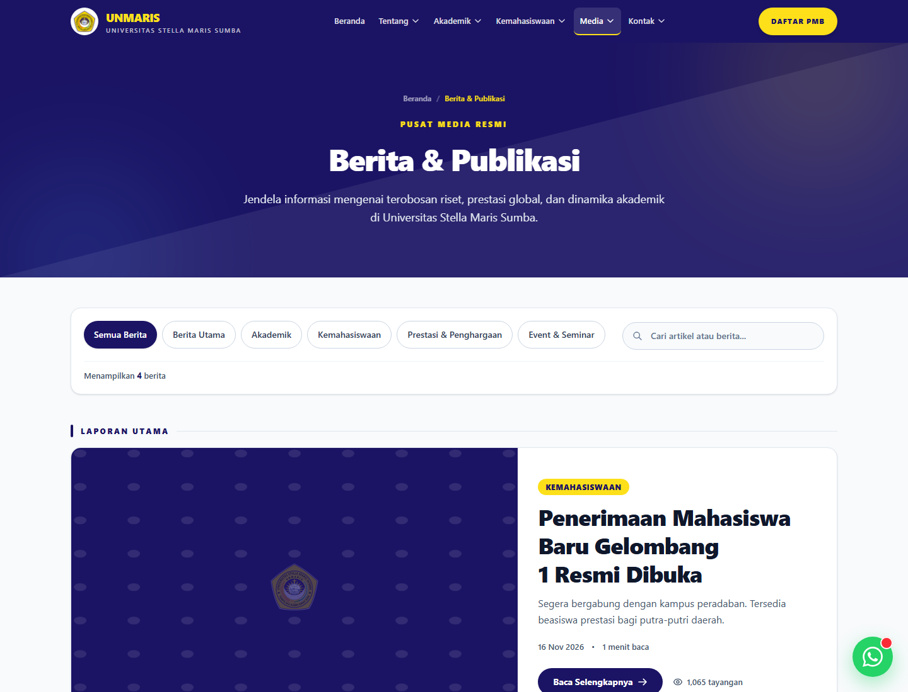
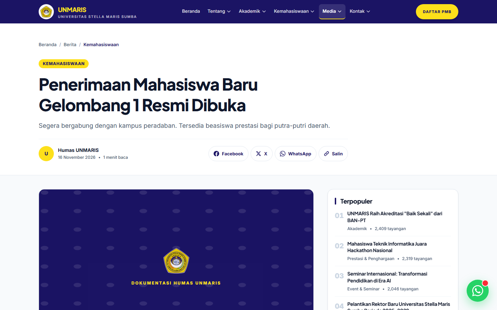
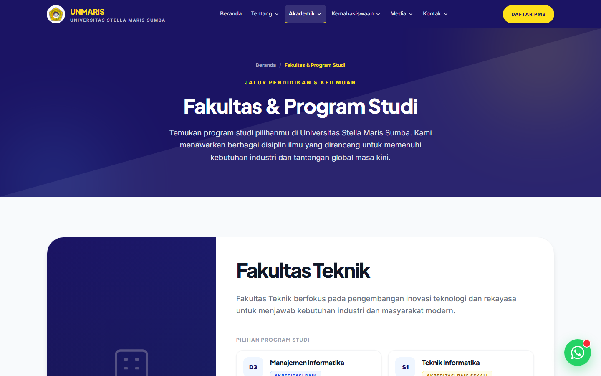
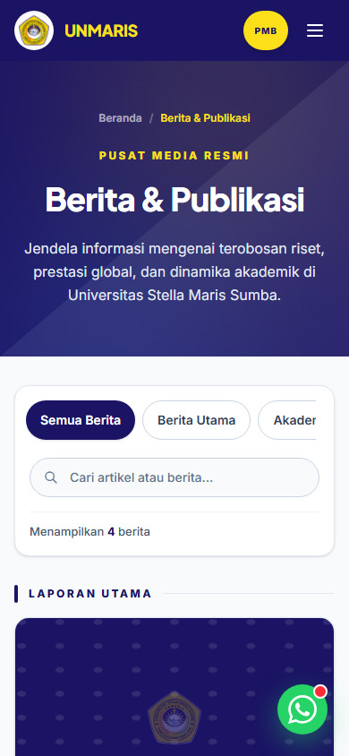
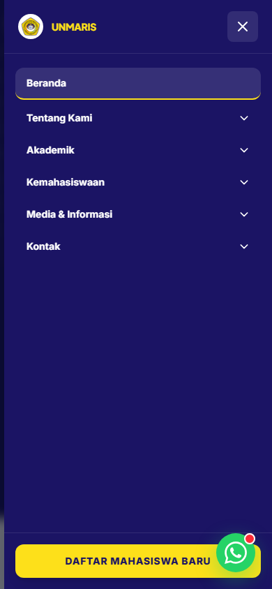
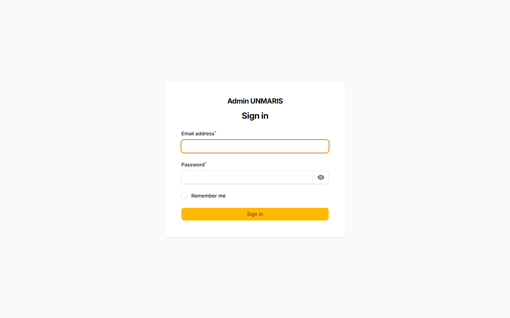

<p align="center">
  
</p>

<h1 align="center">Website Resmi UNMARIS</h1>

<p align="center">
  Portal publik dan panel administrasi <strong>Universitas Stella Maris Sumba</strong><br>
  Dibangun dengan Laravel, Livewire, Filament, dan Tailwind CSS.
</p>

<p align="center">
  
  
  
  
  
  
</p>

---

## Tentang Proyek

Repositori ini berisi kode sumber website resmi Universitas Stella Maris Sumba (UNMARIS). Aplikasi terdiri atas dua bagian:

- **Website publik** — profil universitas, fakultas dan program studi, berita, pengumuman, pusat unduhan, penelitian dan pengabdian (LPPM), kemahasiswaan, statistik mahasiswa, pengaduan, serta kontak.
- **Panel admin** (`/admin`) — pengelolaan seluruh konten di atas melalui Filament, termasuk pengguna, peran, dan log aktivitas.

Antarmuka publik dirancang **mobile-first**, menggunakan identitas visual UNMARIS (navy `#1B1464` dan kuning `#FDE01A`), serta memperhatikan kontras warna, target sentuh minimal 44 px, fokus keyboard yang terlihat, dan preferensi `prefers-reduced-motion`.

---

## Tangkapan Layar

<table>
  <tr>
    <td width="50%">
      
      <br><sub><strong>Beranda</strong> — hero, statistik, dan pintasan layanan</sub>
    </td>
    <td width="50%">
      
      <br><sub><strong>Berita &amp; Publikasi</strong> — filter kategori dan pencarian</sub>
    </td>
  </tr>
  <tr>
    <td width="50%">
      
      <br><sub><strong>Detail berita</strong> — meta, berbagi, berita terkait, dan terpopuler</sub>
    </td>
    <td width="50%">
      
      <br><sub><strong>Fakultas &amp; Program Studi</strong> — akreditasi dan profil prodi</sub>
    </td>
  </tr>
  <tr>
    <td width="33%">
      
      <br><sub><strong>Berita (mobile)</strong></sub>
    </td>
    <td width="33%">
      
      <br><sub><strong>Navigasi seluler</strong></sub>
    </td>
    <td width="33%">
      
      <br><sub><strong>Login admin</strong></sub>
    </td>
  </tr>
</table>

---

## Fitur Utama

### Website Publik

| Modul | Ringkasan |
|---|---|
| Beranda | Slider, berita terbaru, statistik institusi, testimoni, mitra, dan pop-up promo yang dikelola dari admin |
| Profil | Sejarah dan profil universitas, visi-misi, serta daftar pimpinan |
| Fakultas & Prodi | Profil fakultas, struktur organisasi, dokumen, akreditasi, visi/misi/tujuan/prospek karier prodi, dan laporan EDOM |
| Berita | Daftar dengan filter kategori dan pencarian tanpa reload, detail artikel, penghitung berbagi, berita terkait, dan berita terpopuler |
| Pengumuman | Daftar dan detail pengumuman resmi |
| Pusat Unduhan | Dokumen akademik dan institusi dengan filter, pencarian, serta informasi akreditasi dan arsip |
| LPPM | Profil LPPM dan direktori publikasi/jurnal |
| Kemahasiswaan | Beasiswa, organisasi mahasiswa, dan statistik mahasiswa |
| Statistik Mahasiswa | Peta sebaran wilayah dan agregat data mahasiswa dari SIAKAD, tanpa menampilkan data pribadi |
| Layanan | Formulir kontak, pengaduan, dan kanal bantuan WhatsApp |
| SEO & Aksesibilitas | `sitemap.xml`, metadata halaman, navigasi keyboard, dan dukungan `prefers-reduced-motion` |

### Panel Admin

- **Dashboard** — ringkasan berita, program studi, pengunjung, pengaduan, dan pesan terbaru.
- **Manajemen konten** — berita, kategori, tag, pengumuman, halaman statis, slider, fasilitas, fakultas, program studi, pimpinan, mitra, beasiswa, organisasi mahasiswa, penelitian, testimoni, pop-up promo, dokumen, dan laporan EDOM.
- **Interaksi pengunjung** — pesan kontak dan pengaduan dengan status penanganan.
- **Keamanan & tata kelola** — pengguna, peran dan izin (Spatie Permission + Filament Shield), serta log aktivitas.

---

## Teknologi

| Lapisan | Teknologi |
|---|---|
| Backend | Laravel 12, PHP 8.2+ |
| Komponen dinamis | Livewire 4 |
| Panel admin | Filament 5, Filament Shield |
| Tampilan | Blade, Tailwind CSS 4, Alpine.js |
| Build tool | Vite 6 |
| Peta | Leaflet |
| Basis data | MySQL 8 / MariaDB (SQLite untuk pengembangan lokal) |
| Pendukung | Spatie Permission, Spatie Activity Log, Spatie Tags, Laravel Trend |

---

## Persyaratan Sistem

- PHP **8.2** atau lebih baru dengan ekstensi `pdo`, `mbstring`, `openssl`, `fileinfo`, `gd`/`imagick`
- Composer **2.x**
- Node.js **20.x** atau lebih baru dan npm
- MySQL **8.x** / MariaDB **10.6+** (disarankan) atau SQLite
- Web server (Nginx/Apache) untuk produksi

---

## Instalasi

### 1. Klon repositori

```bash
git clone https://github.com/nanutechsolution/unmaris-website.git
cd unmaris-website
```

### 2. Pasang dependensi PHP

```bash
composer install
```

### 3. Siapkan berkas environment

```bash
cp .env.example .env
php artisan key:generate
```

Di Windows PowerShell:

```powershell
Copy-Item .env.example .env
php artisan key:generate
```

Sesuaikan variabel berikut di `.env`:

```dotenv
APP_NAME="UNMARIS"
APP_URL=http://localhost:8000

DB_CONNECTION=mysql
DB_HOST=127.0.0.1
DB_PORT=3306
DB_DATABASE=website_unmaris
DB_USERNAME=root
DB_PASSWORD=

FILESYSTEM_DISK=local
QUEUE_CONNECTION=database
```

> `.env.example` memakai SQLite secara bawaan. Jika memilih MySQL, buat basis data `website_unmaris` terlebih dahulu dan ubah `DB_CONNECTION` seperti contoh di atas.

### 4. Siapkan basis data

Buat basis data MySQL (lewati langkah ini jika memakai SQLite):

```bash
mysql -u root -p -e "CREATE DATABASE website_unmaris CHARACTER SET utf8mb4 COLLATE utf8mb4_unicode_ci;"
```

Jalankan migrasi dan seeder:

```bash
php artisan migrate --seed
php artisan storage:link
```

Seeder menyiapkan data awal: kategori, berita, halaman, fakultas dan program studi, fasilitas, mitra, beasiswa, organisasi, slider, pengguna, serta peran.

### 5. Pasang aset frontend dan build

```bash
npm install
npm run build
```

### 6. Jalankan aplikasi

```bash
php artisan serve
```

Buka `http://127.0.0.1:8000`.

Untuk pengembangan dengan hot reload:

```bash
composer run dev
```

Perintah tersebut menjalankan server Laravel, queue listener, log viewer, dan Vite secara bersamaan.

---

## Panel Admin

Panel admin tersedia di `/admin`.

Akun awal dari `UserSeeder`:

| Field | Nilai |
|---|---|
| Email | `admin@unmaris.ac.id` |
| Password | `password` |

> **Penting:** akun tersebut hanya untuk pengembangan lokal. Segera ganti kata sandi setelah login dan jangan menjalankan seeder pengguna di server produksi tanpa menyesuaikan kredensial.

Peran yang tersedia: `super_admin`, `editor`, dan `akademik`. Pengaturan izin dilakukan melalui menu **Role & Permission** di panel admin.

Panduan operasional tersedia di:

- [`docs/buku-panduan-super-admin.md`](docs/buku-panduan-super-admin.md)
- [`docs/buku-panduan-anggota.md`](docs/buku-panduan-anggota.md)

---

## Halaman Publik

| Halaman | Rute |
|---|---|
| Beranda | `/` |
| Profil universitas | `/profil` |
| Fasilitas | `/fasilitas` |
| Fakultas | `/fakultas` |
| Detail fakultas | `/fakultas/{slug}` |
| Detail program studi | `/fakultas/{facultySlug}/prodi/{prodiSlug}` |
| Berita | `/berita` |
| Detail berita | `/berita/{slug}` |
| Pengumuman | `/pengumuman` |
| Detail pengumuman | `/pengumuman/{slug}` |
| Pusat unduhan | `/akademik/unduhan` |
| Sistem pembelajaran | `/akademik/sistem-pembelajaran` |
| Profil LPPM | `/lppm/profil` |
| Publikasi & jurnal | `/lppm/publikasi` |
| Kemitraan | `/kemitraan` |
| Beasiswa | `/kemahasiswaan/beasiswa` |
| Organisasi mahasiswa | `/kemahasiswaan/organisasi` |
| Statistik mahasiswa | `/kemahasiswaan/statistik-mahasiswa` |
| Pengaduan | `/pengaduan` |
| Kontak | `/kontak` |
| Sitemap | `/sitemap.xml` |
| Panel admin | `/admin` |

---

## Struktur Proyek

```text
unmaris-website/
├── app/
│   ├── Filament/            # Resource, form, tabel, widget panel admin
│   ├── Http/Controllers/    # NewsController, SeoController
│   ├── Livewire/            # Berita, pengumuman, unduhan, publikasi, statistik, pengaduan
│   ├── Models/              # Model Eloquent
│   ├── Providers/           # Service provider, termasuk panel Filament
│   └── Services/            # Layanan agregasi statistik mahasiswa
├── database/
│   ├── migrations/          # Skema basis data
│   └── seeders/             # Data awal dan peran pengguna
├── docs/                    # Buku panduan dan tangkapan layar
├── public/
│   ├── build/               # Hasil build Vite (tidak di-commit)
│   └── images/              # Logo dan aset gambar publik
├── resources/
│   ├── css/app.css          # Tema Tailwind dan token desain UNMARIS
│   ├── js/                  # Entry point JavaScript
│   └── views/
│       ├── components/      # Layout, navigasi, hero, komponen UI
│       ├── livewire/        # Tampilan komponen Livewire
│       └── pages/           # Halaman Blade publik
├── routes/web.php           # Seluruh rute publik
├── scripts/                 # Skrip deploy/rollback fitur akreditasi
├── tests/                   # Tes fitur dan unit
└── tools/                   # Skrip bantu (GeoJSON wilayah)
```

---

## Pengujian dan Kualitas Kode

```bash
# Pasang dependensi pengembangan (phpunit, collision, pint)
composer install

# Menjalankan seluruh tes
php artisan test

# Memeriksa gaya kode PHP
./vendor/bin/pint --test

# Memperbaiki gaya kode secara otomatis
./vendor/bin/pint

# Build aset produksi
npm run build
```

> Jika dependensi dipasang dengan `composer install --no-dev` (seperti pada server produksi), perintah `php artisan test` dan `pint` tidak tersedia. Jalankan `composer install` tanpa `--no-dev` di lingkungan pengembangan.

---

## Deployment

Langkah umum di server produksi:

```bash
git pull --ff-only origin main
composer install --no-dev --optimize-autoloader
npm ci
npm run build
php artisan migrate --force
php artisan optimize
php artisan filament:optimize
php artisan queue:restart
```

Catatan operasional:

- Pastikan `APP_ENV=production` dan `APP_DEBUG=false`.
- Arahkan document root web server ke direktori `public/`.
- Direktori `storage/` dan `bootstrap/cache/` harus dapat ditulis oleh proses web server.
- Jalankan `php artisan storage:link` agar berkas unggahan dapat diakses publik.
- Jalankan worker queue (`php artisan queue:work`) bila fitur antrean digunakan.
- Naikkan `upload_max_filesize` dan `post_max_size` PHP minimal **30 MB** agar unggahan gambar/dokumen fakultas tidak gagal.
- Repositori menyertakan `scripts/deploy-akreditasi.sh` dan `scripts/rollback-akreditasi.sh` untuk deploy fitur akreditasi dokumen. Skrip ini memiliki prasyarat khusus (branch `main`, working tree bersih, `mysqldump`, migration tertentu); baca komentar di dalam skrip sebelum menjalankannya.

---

## Dokumentasi

- [Buku Panduan Super Admin](docs/buku-panduan-super-admin.md) — pengelolaan fakultas, prodi, struktur organisasi, dan dokumen.
- [Buku Panduan Anggota & Publik](docs/buku-panduan-anggota.md) — cara menelusuri fakultas, prodi, dan informasi akademik.

---

<p align="center">
  <sub>Dikelola oleh Universitas Stella Maris Sumba · Sumba, Nusa Tenggara Timur</sub>
</p>
