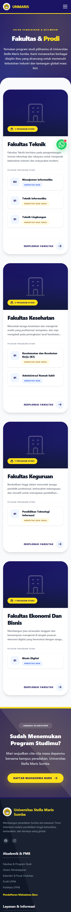
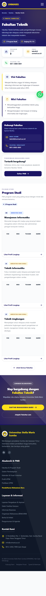
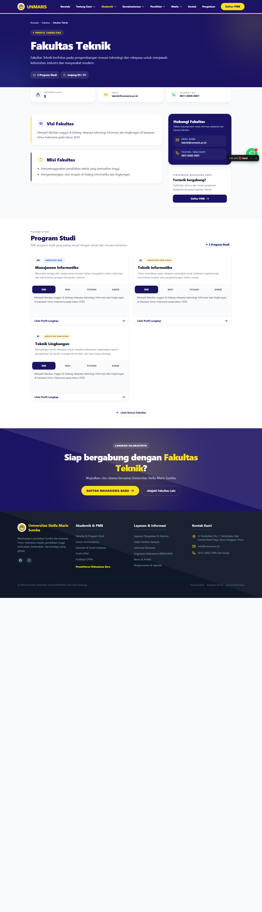
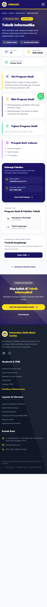

# Buku Panduan Pengguna — Anggota & Publik (Mahasiswa & Pengunjung)

Panduan ini untuk **anggota organisasi / mahasiswa / publik** yang ingin menggunakan
website resmi **Universitas Stella Maris Sumba (UNMARIS)**.

Buku panduan ini mencakup cara menelusuri halaman fakultas dan program studi, membaca
informasi visi, misi, tujuan, dan prospek karir, hingga menghubungi fakultas.

---

## 1. Membuka Halaman Fakultas

### Langkah

1. Buka halaman **Beranda** (`/`) atau langsung ke menu **Fakultas** (`/fakultas`).
2. Pilih **fakultas** yang ingin ditelusuri dari daftar fakultas.

### Tampilan

---

## 2. Membuka Halaman Detail Fakultas

### Langkah

1. Klik nama fakultas yang bersesuaian (misal: **Fakultas Teknik**).
2. Pada halaman detail, pengguna dapat melihat:
   - **Hero fakultas**: deskripsi, jumlah program studi, dan jenjang pendidikan.
   - **Kartu informasi**: program studi, email, dan telepon/WA fakultas.
   - **Visi & Misi fakultas**.
   - **Hubungi fakultas** dan tombol **Daftar PMB**.
   - **Struktur organisasi** dan **dokumen fakultas** (jika sudah diunggah admin).

### Tampilan

---

## 3. Membaca Informasi Program Studi

### Langkah

1. Pada halaman detail fakultas, cari bagian **Program Studi**.
2. Setiap program studi ditampilkan dalam kartu dengan tab:
   - **Visi**
   - **Misi**
   - **Tujuan**
   - **Karir**
3. Tab dengarkan dipilih pada kartu yang ingin dibaca.

### Tampilan Tab Prodi

---

## 4. Membuka Halaman Detail Program Studi

### Langkah

1. Klik nama program studi (atau tombol **Lihat Profil Lengkap**) pada kartu fakultas.
2. Halaman ini menampilkan:
   - **Hero prodi**: jenjang, akreditasi, deskripsi.
   - **Visi, Misi, Tujuan, dan Prospek Karir** program studi.
   - **Informasi fakultas** dan program studi lain di fakultas yang sama.
   - Tombol **Daftar PMB**.

### Tampilan

---

## 5. Menghubungi & Mendaftar

- Gunakan kontak fakultas yang tersedia untuk pertanyaan akademik.
- Klik tombol **Daftar PMB** untuk langsung ke pendaftaran mahasiswa baru.

---

## Catatan Penting untuk Pengguna

- Halaman dirancang **mobile-first**, sehingga nyaman digunakan di ponsel.
- Selalu gunakan tombol/tab resmi untuk membaca informasi fakultas dan prodi.
- Jika data belum tersedia, sistem akan menampilkan *pemberitahuan* bahwa informasi
  tersebut masih kosong.
