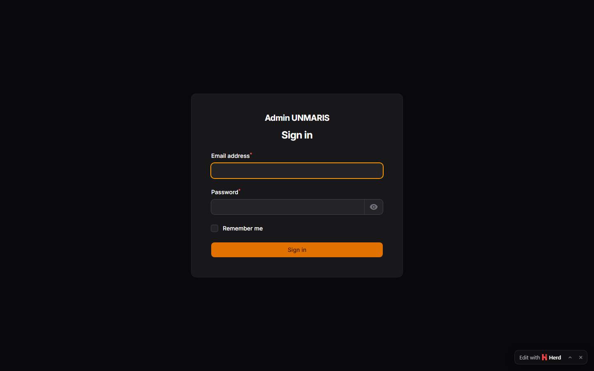

# Buku Panduan Super Admin — Panel Admin UNMARIS

Panduan ini untuk **super admin / editor** yang bertugas mengelola konten website
Universitas Stella Maris Sumba melalui panel admin di:

- URL: `/admin`

Buku panduan ini mencakup alur kerja dasar untuk mengelola **fakultas, program studi,
struktur organisasi, dan dokumen**, serta alur pembuatan data baru.

---

## 1. Login ke Panel Admin

### Langkah

1. Buka halaman **Login Admin** di `/admin`.
2. Masukkan email dan password akun super admin.
3. Setelah login berhasil, akan masuk ke dashboard admin.

### Tampilan

---

## 2. Mengelola Fakultas

### 2.1 Melihat Daftar Fakultas

1. Buka menu **Fakultas** di sidebar admin.
2. Gunakan daftar untuk melihat fakultas yang sudah ada.

### 2.2 Mengunggah Gambar & Dokumen

1. Buka menu **Fakultas** → pilih fakultas yang ingin diedit.
2. Lengkapi field:
   - **Foto Gedung / Logo Fakultas**
   - **Gambar Bagan Struktur Organisasi Fakultas**
   - **Dokumen Fakultas (PDF)**
3. Batas ukuran file: **maksimal 30 MB** (format gambar JPG/PNG, dokumen PDF).
4. Jika upload gagal, pastikan ukuran file tidak melebihi batas dan format sudah sesuai.

---

## 3. Mengelola Program Studi (Prodi)

### 3.1 Menambah / Mengedit Program Studi

1. Buka menu **Program Studi** di sidebar admin.
2. Buat prodi baru atau pilih prodi yang ingin diedit.
3. Isi field:
   - **Nama Program Studi**
   - **Jenjang Pendidikan** (D3 / S1 / S2)
   - **Akreditasi** (Unggul / Baik Sekali / Baik / A / B / C / Belum Terakreditasi)
   - **Deskripsi Singkat**
   - **Visi Keilmuan Prodi** (Rich Editor)
   - **Misi Prodi** (Rich Editor, gunakan bullet/ordered list)
   - **Tujuan Program Studi** (Rich Editor, gunakan bullet/ordered list) ← **fitur baru**
   - **Prospek Karir Lulusan** (Rich Editor, gunakan bullet/ordered list)

### 3.2 Menjawab: "Tujuan Program Studi" untuk siapa?

Field **Tujuan Program Studi** ditambahkan khusus agar prodi memiliki tujuan yang
lebih spesifik selain visi dan misi. Data ini nantinya ditampilkan di:

- Halaman fakultas detail → tab **Tujuan** pada kartu prodi.
- Halaman detail prodi → bagian **Tujuan Program Studi**.

---

## 4. Membuat Akun & Akses

- Gunakan akun dengan peran **Super Admin** untuk akses penuh ke admin.
- Kelola peran admin/editor melalui menu **Role & Permission** di panel admin.

---

## Catatan Operasional

- Jika upload gagal, cek:
  1. Ukuran file ≤ 30 MB.
  2. Format (JPG/PNG untuk gambar, PDF untuk dokumen).
  3. Koneksi internet / server.
  4. Informasi error tersimpan di `storage/logs/laravel.log`.
- Pastikan `php artisan migrate` sudah dijalankan agar kolom `tujuan` tersedia.
- Jalankan `npm run build` setelah menambah kelas Tailwind baru pada tampilan publik.
